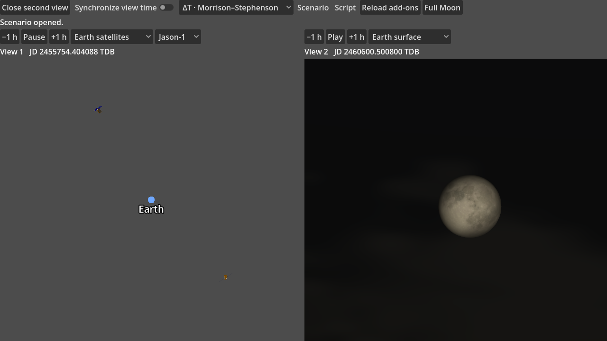

# SpaceTangent

SpaceTangent is a desktop 3D astronomy simulator for exploring the Earth–Moon system and replaying spacecraft trajectories from real mission data. It is an early preview with a verified Windows build.



*Jason-1 and an Earth-surface view of the full Moon at two different simulation epochs.*

## Quick start

On Windows, install Git, Godot 4.7.2 **.NET**, the .NET SDK specified in [`global.json`](global.json), and the .NET 8 runtime. Put the Godot .NET executable on your `PATH` as `godot`, or use its full path in the commands below.

```powershell
git clone --recurse-submodules https://github.com/DustFinch/space-tangent.git
Set-Location space-tangent
$project = 'src/SpaceTangent.Godot'
$data = Join-Path $project '.local-data'
New-Item -ItemType Directory -Force -Path $data | Out-Null
curl.exe --fail --location --output (Join-Path $data 'de440.440') https://ssd.jpl.nasa.gov/ftp/eph/planets/Linux/de440/linux_p1550p2650.440
dotnet restore "$project/SpaceTangent.Godot.csproj" --locked-mode
dotnet build "$project/SpaceTangent.Godot.csproj" --no-restore
godot --headless --path $project --editor --import --quit
godot --path $project
```

The simulation opens with its clock paused at J2000. Switch from **Solar overview** to **Earth–Moon view**, then use **+1 h** or **Play** to see the Moon move. The [first simulation guide](docs/FIRST_SIMULATION.md) explains the initial views and links to the DE440 checksum.

## What you can explore

- Follow [Jason-1 and SORCE](docs/SCIENCE_ADDONS.md) using their original two-line elements, spacecraft models, and textures.
- Replay [Cassini and Huygens](docs/CASSINI_MISSION.md), including Cassini's camera fields of view and footprints on Saturn.
- Inspect [lunar relief from LRO LOLA](docs/LUNAR_TERRAIN.md) from a global or a regional view.
- Open the [full-Moon scene](docs/MOON_LIGHTING.md) to see reflected moonlight on Earth's clouds.
- Open [two views](docs/OBSERVERS.md) with independent or synchronized clocks and save their state as a scenario.

## Supported data and current limits

The repository contains the simulator and test fixtures. DE440 is the only external file needed for the first scene. The workflows above link to the separate catalogs, kernels, meshes, and textures they use. Each input retains its own distribution terms.

The preview offers preset camera modes. SSC, SPICE mission JSON, and [observer Lua scripts](docs/LUA_SCRIPTS.md) have documented subsets. The [validation notes](docs/RELEASE_NOTES.md) list the original data and workflows exercised on Windows.

## Build, test, and contribute

Use the [Windows export guide](docs/WINDOWS_BUILD.md) to build a standalone executable. To run the first data-backed smoke test after the Quick Start, run these commands from the same PowerShell session.

```powershell
$env:SPACETANGENT_DE440 = (Resolve-Path (Join-Path $data 'de440.440')).Path
godot --headless --path $project res://tests/BootstrapSmoke.tscn
```

The simulator pins [SpaceTangent Core](https://github.com/DustFinch/space-tangent-core) as a Git submodule. For a bug report, include the revision, scene or catalog, and steps to reproduce it. [GitHub Issues](https://github.com/DustFinch/space-tangent/issues)

## License

The source code is licensed under [GPL-2.0-or-later](COPYING). The workflow guides above identify the external data sources used by the example scenes.
