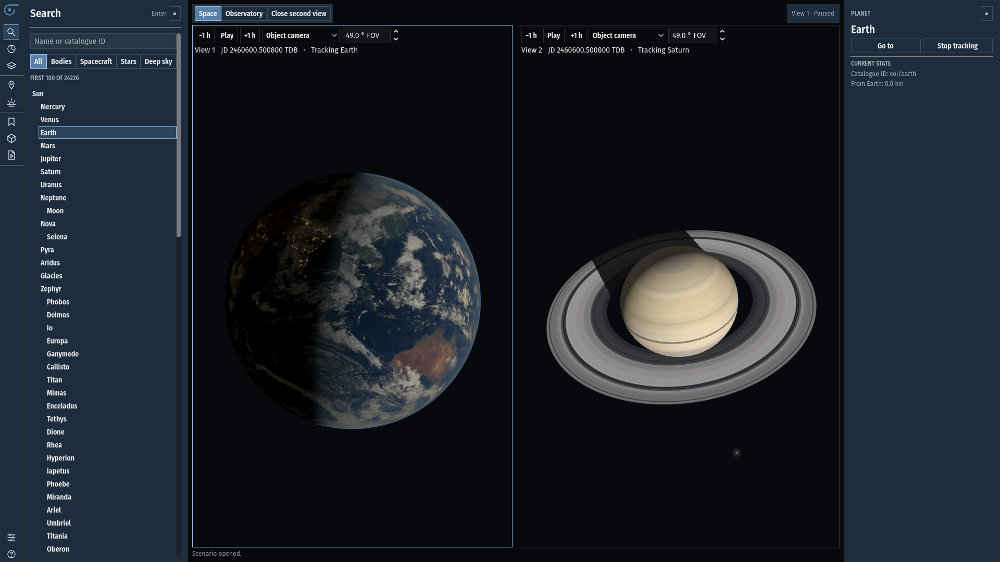

# SpaceTangent

SpaceTangent is a 3D astronomy simulator for flying through the Solar System, exploring the sky from Earth, and replaying spacecraft missions from real trajectory data. It runs on Godot .NET and has been verified on Windows.



*Earth at the terminator and Saturn's rings in two independently controlled views. Earth imagery from NASA Earth Observatory. Saturn textures from CelestiaContent. [Planetary data notes](docs/PLANET_DATA.md) · [Saturn asset sources](https://github.com/CelestiaProject/CelestiaContent/tree/60316cf1c7df289b44b3c99711913bdbf1daea2e/textures/hires)*

## Quick start

On Windows, install Git, Godot 4.7.2 **.NET**, the .NET SDK specified in [`global.json`](global.json), and the .NET 8 runtime. Put the Godot .NET executable on your `PATH` as `godot`, or use its full path in the commands below.

```powershell
git clone --recurse-submodules https://github.com/DustFinch/space-tangent.git
Set-Location space-tangent
$project = 'src/SpaceTangent.Godot'
$data = Join-Path $project '.local-data'
New-Item -ItemType Directory -Force -Path $data | Out-Null
curl.exe --fail --location --output (Join-Path $data 'de440.440') https://ssd.jpl.nasa.gov/ftp/eph/planets/Linux/de440/linux_p1550p2650.440
dotnet restore "$project/SpaceTangent.Godot.csproj" --locked-mode
dotnet build "$project/SpaceTangent.Godot.csproj" --no-restore
godot --headless --path $project --editor --import --quit
godot --path $project
```

On a fresh start, the simulator opens in a perspective view near Earth with time paused at J2000. Search for Saturn, right-click its result, and choose **Go to**. Use **+1 h** or **Play** to advance time. **Inner planets** opens the orbital overview. See the [first simulation guide](docs/FIRST_SIMULATION.md) for the camera modes. The [DE440 notes](https://github.com/DustFinch/space-tangent-core/blob/main/docs/DE440.md) include the download checksum.

## What you can explore

- Fly to planets, moons and small bodies. Add planetary maps for textured surfaces, atmospheres and ring profiles. Explore lunar relief or start on Earth under a full Moon. [Planetary maps](docs/PLANET_DATA.md) · [Lunar terrain](docs/LUNAR_TERRAIN.md) · [Moon lighting](docs/MOON_LIGHTING.md)
- Open a split view, track different targets and run the clocks independently or in sync. Save the cameras, epochs and ΔT in a scenario. [Observers and views](docs/OBSERVER_VIEWS.md)
- Observe stars, constellations and deep-sky objects from Earth or space. Set a ground observing site, search for eclipses and satellite passes, and inspect local sky conditions. [Observing](docs/OBSERVERS.md) · [Star and deep-sky catalogues](docs/SPATIAL_SKY.md)
- Follow Jason-1 and SORCE or replay Cassini and Huygens. Load supported SSC catalogues, sampled trajectories and SPICE mission data from local add-ons. [Science satellites](docs/SCIENCE_ADDONS.md) · [Cassini and Huygens](docs/CASSINI_MISSION.md) · [SSC catalogues](docs/SSC_BODY_CATALOGUES.md) · [Sampled missions](docs/SAMPLED_MISSIONS.md)
- Run Lua observer scripts or convert supported CEL commands into tours. [Lua scripts](docs/LUA_SCRIPTS.md) · [Tours](docs/TOURS.md)

DE440 supplies the base ephemeris. The maps and mission datasets shown above are optional local inputs with their own distribution terms. The format guides specify the supported catalogue fields and kernel types.

## Build and validate

Use the [Windows export guide](docs/WINDOWS_BUILD.md) to build a standalone executable. To run the data-backed smoke test after the Quick Start, use the same PowerShell session.

```powershell
$env:SPACETANGENT_DE440 = (Resolve-Path (Join-Path $data 'de440.440')).Path
godot --headless --path $project res://tests/BootstrapSmoke.tscn
```

The Windows transfer verification included original mission add-ons, 80 rendered captures and a one-hour test in the Jason-1 and full-Moon scene. Both cameras, their independent epochs and ΔT were checked after each of 20 add-on reloads.

The simulator pins [SpaceTangent Core](https://github.com/DustFinch/space-tangent-core) as a Git submodule. When reporting a bug, include the revision, scene or catalogue, and steps to reproduce it. [GitHub Issues](https://github.com/DustFinch/space-tangent/issues)

## License

The source code is licensed under [GPL-2.0-or-later](COPYING). The linked data guides identify the sources and terms for optional assets.
