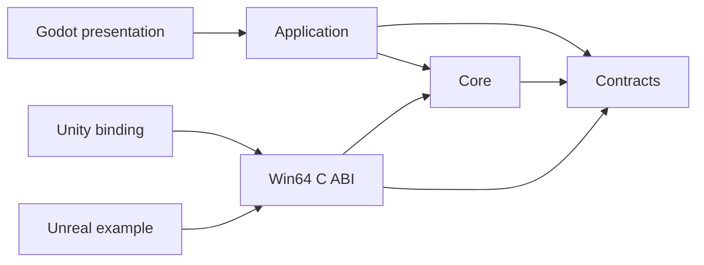

# Simulation and engine boundaries

SpaceTangent keeps numerical evaluation, application state and engine presentation in separate assemblies. The simulator pins a tested core revision through its submodule.

`SpaceTangent.Contracts` defines shared values such as exact epochs, identities and Cartesian states. `SpaceTangent.Core` evaluates models, reference frames and imported data without an engine dependency. `SpaceTangent.Application` combines those values into a world and observer workflows. The Godot project owns nodes, controls, rendering resources and window capture.

The native ABI currently exposes ephemeris queries. Its engine examples validate embedding; each engine owns its presentation. See [the core's ABI contract](../deps/space-tangent-core/docs/NATIVE_ABI.md) for the supported layout, ownership and validation scope.

## State and identity

`SimulationWorldAssembly` builds the installed catalogue and evaluation graphs; `SimulationWorld` keeps their public query facade. `SimulationSession` owns live observers and delegates linked/independent time changes to `ObserverClock`, complete scenario validation to `ScenarioRestoration`, and camera entry requirements to `CameraModeRules`. UI and scripts keep the same session operations. The adapter reads that state to update controls and rendering.

A view index describes its current place in the layout. A lifetime identity keeps callbacks attached to the same live observer when another view closes. A persistent place-history key identifies saved observing locations. These identities have different lifetimes: splitting forks place identity, restoring a scenario replaces live callback identities, and ordinary add-on reload preserves the session and its views.

Observers retain exact TDB epochs. Linked views share their clock owner's epoch, play state and rate; independent views retain their own clocks. The selected delta-T model affects derived calculations such as Earth orientation without replacing the saved TDB epoch.

`ObserverBookmarkStore` owns bookmark collection changes and publishes its visible list after successful persistence. The existing file codec and scene-link privacy rules remain shared by UI and imports.

`ObserverPlaceAutosave` owns one session's frozen preferences path, revision tracking, debounced writes and retry delay. The adapter decides whether startup policy enables it and displays failures; scenarios, replay and batch startup keep their existing privacy rules.

`ObserverWorkspaceReader` owns archived-input classification streams; the adapter retains the order of replay shutdown and scenario parsing. `DeltaTPreferenceFile` keeps the existing named-model preference format and atomic replacement independently of engine path discovery.

Scenario restoration validates the complete input before changing live state. Saved scenarios and recordings preserve place history, while shared links and bookmarks retain the active cameras without publishing unrelated private locations. See [observer views](OBSERVER_VIEWS.md).

## Data preparation and publication

`AddonLoader` resolves engine-specific source locations and schedules preparation with explicit `AddonPreparationInputs`. `AddonPreparation` in Application reads catalogues, tracks dependencies, decodes meshes and terrain, and prepares observation samples without an engine reference. Its diagnostic callbacks run on the calling worker. The Godot adapter publishes Texture/Mesh resources on the main thread and preserves unchanged decoded/resource identities across reloads.

`AddonLoadCoordinator` owns the loading generation and cancellation source. It cancels superseded work and invalidates pending results when its owner closes. The scene additionally checks its native lifetime and tree membership before publication. A completed request may publish only while it remains current and its scene owner is alive. Cancelled work must release candidate-owned data without disposing an index or asset still shared by the active generation. All views must finish switching before a superseded shared resource is released.

Reload preserves the last successful world on rejected input and keeps the observers' epochs, cameras, selection and delta-T whenever the replacement supports them. Requested source preferences are saved for the successfully applied world. A failed synchronous preference commit restores the previous world, observer records and unfinished flights before the adapter switches its live generation. The previous distant-star index is retired after all live views have switched. SharedResourceRetirement holds it until captured reloads and observer calculations finish; weak retirement records do not retain disposed catalogues. Content hashes and recorded failed lookups determine cache validity. See [add-on cache contracts](ADDON_CACHE.md).

## Frame evaluation

`SolarSystemScene` connects application workflows, controls and views. `ObserverViewHost` owns control creation, active-index remapping, layout dividers and their callbacks, and suppression of programmatic field updates. It receives typed observer actions and explicit renderer creation/resource-binding callbacks, preserving the original node-ready order. `ObserverNavigationInput` owns held movement keys, pointer gestures and inertia, translating engine input into the same session operations through narrow presentation callbacks. Pre-ready release state and focus-loss cleanup retain their original lifetimes.

`ObserverTimePanel` owns clock and calendar controls and their display cache. Typed commands keep time changes in the session; the panel reads the active observer without reaching into scene fields.

`ObserverCalculationSlot` owns supersession and shutdown of each background calculation channel. Cancellation sources remain alive until their worker scopes complete; the event/night shared channel keeps its original behavior. `ObserverScriptPlayer` owns foreground Lua and its view media, with separate ports for rendering, view operations, capture and status. Plugins retain their own quotas and lifecycle.

`SimulationViewport` coordinates a view's drawing and picking. `MissionTrailRendering` owns its rolling samples, publication keys and trail mesh while consuming the already evaluated frame and explicit projection/settings. `OpticalRendering` owns the eyepiece, display cache and resize redraw; `ObserverRenderFrame` carries captured observer/snapshot/ΔT inputs without evaluating the world again. Other rendering areas retain their existing owners while they are separated incrementally.

Rendering consumes a world snapshot evaluated at the observer's epoch and delta-T model. Reuse is valid only for the same relevant world and time dependencies. Stateful imported Lua models retain their evaluation order; background observation calculations use the world's graph that excludes scripted models and their unsafe dependencies.

Mission trails and selected-body paths retain their published data while preparing replacements. Changing their world, target, centre, style or time dependencies invalidates the appropriate work. At capture boundaries, screenshots, recording and replay require the complete current paths. Incremental budgets and synchronous freshness fallbacks are described in [runtime profiling](PERFORMANCE.md).

## Verification boundaries

Scientific values, persistence, rendered images and performance have separate checks. C# line coverage does not establish shader accuracy, frame latency or compatibility with every external data set. Public CI exercises pinned public inputs; the complete local-data matrix additionally includes real add-ons and isolated rendered workflows.

Performance comparisons use the same workload, inputs, runtime, hardware and resolution without coverage instrumentation. Raw profiles include allocation and GC context, and frame readbacks are reported as wall time. Test scenes and diagnostic workload hosts are excluded from exported releases. See [coverage and acceptance](TEST_COVERAGE.md) for the evidence and failure policies.
