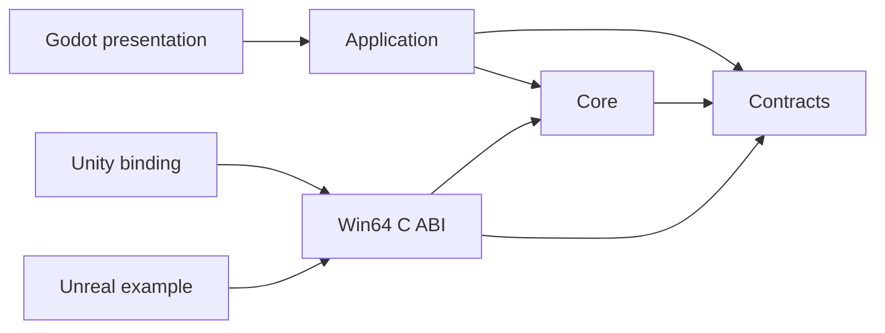

# Simulation and engine boundaries

SpaceTangent keeps numerical evaluation, application state and engine presentation in separate assemblies. The simulator pins a tested core revision through its submodule.

`SpaceTangent.Contracts` defines shared values such as exact epochs, identities and Cartesian states. `SpaceTangent.Core` evaluates models, reference frames and imported data without an engine dependency. `SpaceTangent.Application` combines those values into a world and observer workflows. The Godot project owns nodes, controls, rendering resources and window capture.

The native ABI currently exposes ephemeris queries. Its engine examples validate embedding; each engine owns its presentation. See [the core's ABI contract](../deps/space-tangent-core/docs/NATIVE_ABI.md) for the supported layout, ownership and validation scope.

## State and identity

`SimulationWorld` provides the installed catalogue and evaluation graphs. `SimulationSession` owns live observers, time controls, navigation and the transitions used by the interface and scripts. The adapter reads that state to update controls and rendering.

A view index describes its current place in the layout. A lifetime identity keeps callbacks attached to the same live observer when another view closes. A persistent place-history key identifies saved observing locations. These identities have different lifetimes: splitting forks place identity, restoring a scenario replaces live callback identities, and ordinary add-on reload preserves the session and its views.

Observers retain exact TDB epochs. Linked views share their clock owner's epoch, play state and rate; independent views retain their own clocks. The selected delta-T model affects derived calculations such as Earth orientation without replacing the saved TDB epoch.

Scenario restoration validates the complete input before changing live state. Saved scenarios and recordings preserve place history, while shared links and bookmarks retain the active cameras without publishing unrelated private locations. See [observer views](OBSERVER_VIEWS.md).

## Data preparation and publication

`AddonLoader` resolves engine-specific source locations, prepares decoded data and publishes rendering assets. Source decoding and dependency validation run on workers. Godot resource creation and publication belong to the main thread.

The scene tracks the current loading generation and cancellation token. A completed request may publish only while it remains current and its scene owner is alive. Cancelled work must release candidate-owned data without disposing an index or asset still shared by the active generation. All views must finish switching before a superseded shared resource is released.

Reload preserves the last successful world on rejected input and keeps the observers' epochs, cameras, selection and delta-T whenever the replacement supports them. Requested source preferences are saved for the successfully applied world. Content hashes and recorded failed lookups determine cache validity. See [add-on cache contracts](ADDON_CACHE.md).

## Frame evaluation

`SolarSystemScene` connects application workflows, controls and views. `SimulationViewport` owns a view's drawing and picking. Their partial files group related implementation; component ownership must remain explicit across those files.

Rendering consumes a world snapshot evaluated at the observer's epoch and delta-T model. Reuse is valid only for the same relevant world and time dependencies. Stateful imported Lua models retain their evaluation order; background observation calculations use the world's graph that excludes scripted models and their unsafe dependencies.

Mission trails and selected-body paths retain their published data while preparing replacements. Changing their world, target, centre, style or time dependencies invalidates the appropriate work. At capture boundaries, screenshots, recording and replay require the complete current paths. Incremental budgets and synchronous freshness fallbacks are described in [runtime profiling](PERFORMANCE.md).

## Verification boundaries

Scientific values, persistence, rendered images and performance have separate checks. C# line coverage does not establish shader accuracy, frame latency or compatibility with every external data set. Public CI exercises pinned public inputs; the complete local-data matrix additionally includes real add-ons and isolated rendered workflows.

Performance comparisons use the same workload, inputs, runtime, hardware and resolution without coverage instrumentation. Raw profiles include allocation and GC context, and frame readbacks are reported as wall time. Test scenes and diagnostic workload hosts are excluded from exported releases. See [coverage and acceptance](TEST_COVERAGE.md) for the evidence and failure policies.
